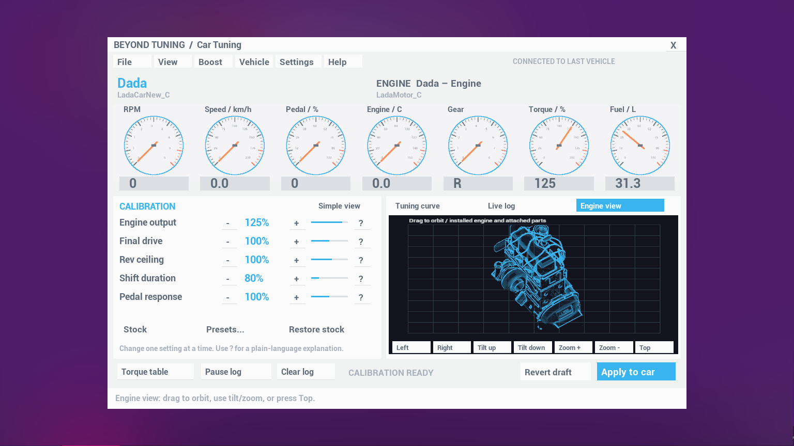

# Beyond Tuning

**Car Tuning** brings a desktop-style calibration workspace to the computers in **Drive Beyond Horizons**. Seven live gauges, a torque correction table, a live trace and a rotatable 3D hologram of the installed engine sit inside a native in-game window.

Built using the computer-window and input-surface approach established by Beyond Apocalypse's Hangar app. Beyond Tuning is a separate mod and does not replace Beyond Apocalypse files.



## Install

Windows x64, Drive Beyond Horizons build 26106988, and a compatible UE4SS installation are required. Developed alongside Beyond Apocalypse 1.0.10. Beyond Apocalypse is optional; when installed, Beyond Mod Manager loads it first.

**Beyond Mod Manager:** import `BeyondTuning-1.1.1-Nexus.zip`, inspect the preview, and install. The manifest supplies identity, version, load order, GitHub updates and preservation rules for your presets and settings.

**Manual:** exit the game and extract the ZIP into the main `Drive Beyond Horizons` game folder. The resulting path is `DriveBeyondHorizons/Binaries/Win64/ue4ss/Mods/BeyondTuning/Scripts/main.lua`. The included `enabled.txt` enables the mod. This package does not include or replace UE4SS.

## Your first tune

1. Sit in the car you want to tune. Open a computer, or use a mounted laptop from the driver seat.
2. Open **Car Tuning**. Check the car and engine listed at the top. **Vehicle** shows exact class identifiers and installed hardware.
3. Open **File > Presets** for Drift and Race examples matching your installed engine, or choose All / saved for the full library. All changes start as a draft.
4. Press **Apply to car**, including while moving. In multiplayer the host validates and saves the request, then confirms and distributes it to the other players.
5. Drive the same route and compare the **Live log**. Apply has already saved the calibration to disk. Save the game to keep the car itself and your game progress.

The target remains the last car you sat in during this game session. A different car or engine starts its own calibration. Presets are reusable across cars; applied tunes belong to a particular chassis and engine pair.

## What the controls actually change

| Control | Effect |
| --- | --- |
| Engine output | Multiplies the game's native torque result. Higher output also increases native fuel consumption and heat production. |
| Final drive | Shortens or lengthens native gear speed ranges and shift thresholds, with corresponding gear torque changes. Higher values favor acceleration. |
| Rev ceiling | Changes the tuning limiter and free-rev ceiling. Torque cuts above the selected ceiling; the engine's original gearbox RPM ranges remain the reference. |
| Shift duration | Changes the native time spent changing gears. Lower values shift more quickly. |
| Pedal response | Changes part-throttle torque delivery. It does not add full-throttle output on its own. |
| Individual turbos | Scales each fitted turbo's native boost contribution independently, from 25–200%. Unfitted slots are ignored. |
| Nitrous injection | With Beyond Apocalypse and a fitted bottle: 25–200% injection. Half injection gives half force and approximately twice the bottle duration; double injection reverses the tradeoff. BA keeps its activation and safety rules. |
| Torque table | Applies a smoothly interpolated correction across five pedal rows and eight RPM columns. 100 is neutral. |

**Restore stock** restores the captured native settings and removes that car/engine's saved tune. **Revert draft** discards unapplied edits. Power and the torque table multiply together, so make small changes and compare.

Curve previews the engine correction before turbo/nitrous effects, not measured horsepower or a simulated fuel/ignition ECU. Live log shows real RPM, vehicle speed and pedal readings over the last 15 seconds. Engine view captures the actual installed engine and attached-part meshes with a transparent background. Drag to orbit, use tilt/zoom buttons, or press Top. All 21 current engine catalog classes were checked at two angles. This is an exterior hologram view, not an internal mechanical simulation.

**Handling** cycles Stock, Drift and Race. **Gears** cycles the original layout, short drift ratios, and a race spread with stronger launch gears and taller high gears. Gear count and reverse are preserved.

**Boost** lists each installed turbo by its slot. Turbo percentages describe the game's boost contribution, not PSI. Nitrous shows **Unavailable** without Beyond Apocalypse, or when no BA bottle is attached. Hold Shift while driving to activate BA nitrous after applying the tune. An empty bottle produces no extra force. Standalone engine, gearbox and turbo tuning do not require BA.

## Engine examples

There are **42 examples: Drift and Race for all 21 engines** in the supported game build. The default Presets page puts your installed engine's pair first. All / saved exposes the other engines and your own library.

Drift uses the game's native drift-assist component, the measured SLIDY grip and steering-speed settings, rear-wheel drive, a wider steering range, short gears and an engine-family torque map. Race selects maximum engine/table output and fitted-turbo contribution, fast shifts, extra grip, low rolling resistance, stronger launch gears and taller top gears. These are editable examples; road surface, tires, load and engine condition still affect the result. Maximum power also produces more heat and consumes more fuel. No tune can guarantee the fastest result on every car and road.

Nitrous examples use 50% injection for Drift and 200% for Race. Those values take effect only with BA nitrous fitted. Unfitted hardware is never invented or added by a preset.

## Portable laptop

Open **Car Tuning > File > Laptop / Buy for $250**. The laptop is delivered beside you using in-game money. It uses ZwiebelGames' imported, textured folding laptop model: 2,012 triangles, with a separate base, lid and screen.

- **Left-click the open screen** to open the native desktop, including other installed computer apps. A closed laptop cannot open the desktop.
- **Right-click the bezel/lid** to open or close it.
- **Left-click the closed laptop** to pick it up. Left-clicking the open lid/bezel also picks up the body.
- Pick up the base and use the game's normal attachment controls to mount the bottom on a vehicle or other object.
- A mounted laptop can be used from the driver seat. **Esc** or **Return to laptop** exits the desktop and freezes its last image. Clicking the screen resumes the workspace.
- Save your game to retain the physical laptop and its attachment. Its lid state and frozen display are stored in the mod's preserved state folder.

The idle display is a still texture. There is no idle camera capture, live desktop rendering or hologram animation. The native desktop proxy and temporary capture component exist only during use/capture. Visible mesh rendering, stored textures and normal loose-item physics still have their ordinary engine costs.

## Multiplayer

Install the same Beyond Tuning version on the **host and every participating client**. The host owns the authoritative per-world tune journal. Clients submit validated requests over existing reliable player-controller messages; no additional ports, services or accounts are required. Applied settings synchronize to the other players and late joiners. Save identity markers keep the same car and engine matched even when native IDs differ on clients.

Sit in your friend's car, then use a computer. Your friend can drive or rev that car while you watch the live gauges and trace and apply changes. The driver streams readings only while someone is watching; host-side telemetry supplies the fallback. The optional **engine heat overlay** colors the existing hologram using actual engine temperature. It represents one measured engine temperature, not a per-cylinder thermal simulation.

The host must acknowledge a saved request before the app reports success. Presets remain local reusable files; use Export / Import to share them. Two simultaneous edits follow the order accepted by the host.

## Presets and appearance

- **Save preset:** enter a name under File and save the current draft into the mod's `presets` folder.
- **Export:** choose a destination in the Windows Save As dialog, then share the JSON file.
- **Import / drop JSON:** drag one JSON preset onto the dedicated import window, or select Browse. It is validated and permanently saved in the preset library. A conflicting name gets a numbered copy. Return to the game, review the draft, then Apply. JSON is never executed.
- **Open preset folder:** opens the folder in Explorer. You can also copy JSON files there and press Refresh presets.
- **Settings:** Classic or Dark, five interface accents, five graph/hologram colors, a live heat-color overlay, km/h or mph, and Simple view.
- **Help:** includes the same beginner workflow and import/export instructions inside the app.

The drop target is the small Windows import window, not the game's viewport. Use a windowed or borderless game if you want to drag from Explorer without switching away from exclusive fullscreen.

## Saves, compatibility and removal

**Presets and applied tunes persist through game saves, crashes and restarts.** Apply writes the active calibration to `BeyondTuning/state` immediately, before changing the car, and creates a reusable **Last applied** preset for that chassis/engine pair. Imported and manually saved presets live in `BeyondTuning/presets` independently of game saves. Backup files provide recovery if a write is interrupted.

Loading an older save of the same world retains the latest applied calibration for matching car/engine identities. Native save revisions also receive calibration snapshots. Keep both `state` and `presets` when moving to another PC. The mod cannot recover a car the game itself never saved; its Last applied preset remains available for another car. Draft edits are temporary until Apply or Save preset. Restore stock is an intentional calibration reset; reusable presets remain available.

The mod runs on the game thread and uses the same native computer UI methodology as Hangar. It does not replace Apocalypse files or hooks, ship private companion code, or redistribute game meshes. The optional nitrous adapter adjusts measured native fluid consumption and the corresponding native boost force while BA owns activation. At 100% it leaves the behavior unchanged. Engine images are generated locally at runtime. Presets contain data only. The small native DLL provides Windows file dialogs, drag/drop, pointer position while dragging the model, and image contour conversion; it has no network access.

Tuning is host-authoritative; clients can request changes and receive a saved confirmation. Native reliable request/response and host persistence were exercised locally. A separate two-PC multiplayer session has not been validated. Other mods which replace native torque, gear arrays or engine calibration can conflict. Future game builds may change the reflected APIs. See TESTING.md for the exact coverage.

Use Beyond Mod Manager to disable or uninstall while the game is closed. Save desired reusable presets first. Re-enabling restores access to the retained state. For manual removal, remove the `BeyondTuning` folder after backing up `state` and `presets` if you want to keep them.

## Source and build

Lua 5.4 scripts are under `mod/BeyondTuning/Scripts`. The Windows helper source is `native/preset_bridge.c`. Build the DLL with Zig 0.14.1 and package with Python 3:

```powershell
.\build.ps1 -Zig C:\path\to\zig.exe
```

Run pure Lua tests from the repository root with `lua tests/policy.lua`. See `TESTING.md` for runtime checks and coverage limits. Packaging uses an explicit allowlist so runtime images, tuning journals, personal presets and development tools are excluded.

Source: https://github.com/lionlord513/beyond-tuning

Drive Beyond Horizons and Unreal Engine assets belong to their respective owners. Beyond Tuning is an unofficial mod. The interface is inspired by common automotive calibration tools and uses original UI code and graphics.

Laptop model: [Old low-poly laptop (PSX retro prop)](https://sketchfab.com/3d-models/old-low-poly-laptop-psx-retro-prop-a2d9f3d0080b412983e19825aace11b5) by [ZwiebelGames](https://sketchfab.com/ZwiebelGames), [CC BY 4.0](https://creativecommons.org/licenses/by/4.0/). Mesh conversion, a hinged pivot and screen UV changes are credited in the included asset attribution.
